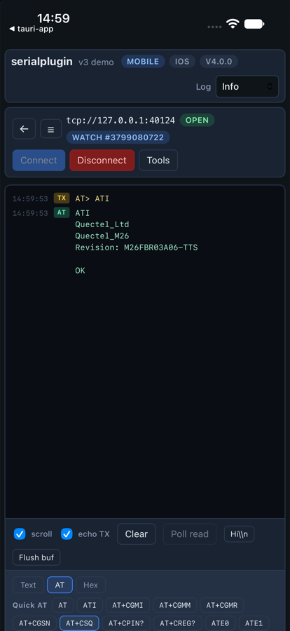
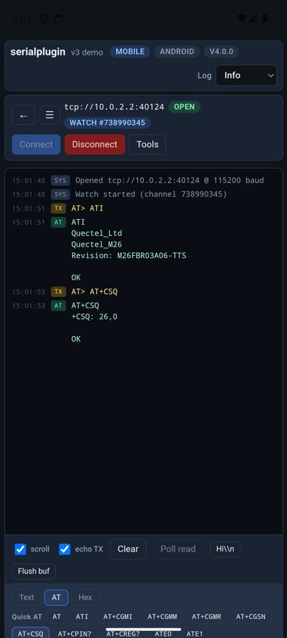

Any path of the form `tcp://host:port` talks raw bytes to a TCP serial bridge:
`ser2net` (raw mode), ESP-Link, Moxa/USR device servers, or `socat`:

```bash
socat TCP-LISTEN:4000,reuseaddr,fork FILE:/dev/ttyUSB0,raw,echo=0,b115200
```

```ts
const port = new SerialPort({ path: "tcp://192.168.1.50:4000", baudRate: 115200 });
await port.open();
await port.watch({ onData: console.log });
```

- When the bridge closes the connection you get `onDisconnect`, like an unplug.
- Baud rate, parity and modem lines are kept locally and not sent; configure the
  serial side on the bridge (RFC 2217 is not implemented).
- Use **one client per bridge**. A serial line has a single reader: with a forking
  bridge and two clients, each reply goes to whichever connection reads first.
  `ser2net` allows one connection per port by default.

The example app on iOS and Android, talking to a Quectel M26 modem through
`socat` on the host:

{width="300"}
{width="300"}
