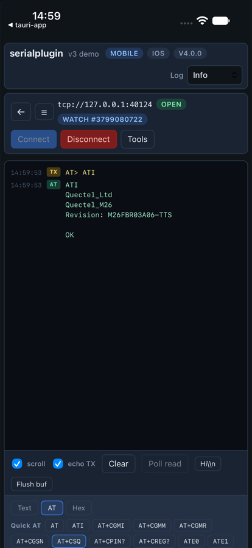
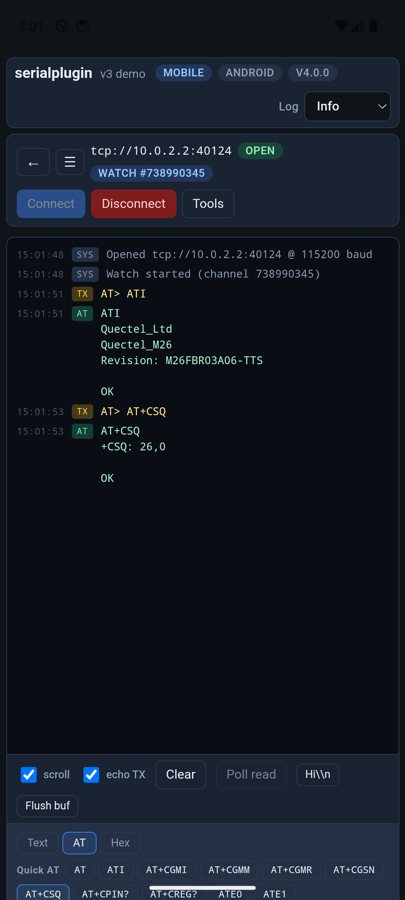

# Platforms and transports

| Platform | Local ports | `tcp://` | `ble://` (feature `ble`) |
|----------|-------------|----------|--------------------------|
| Windows | COM ports (`serialport`) | yes | yes |
| macOS | `/dev/cu.*`, `/dev/tty.*` | yes | yes |
| Linux | `/dev/ttyUSB*`, `/dev/ttyACM*`, … | yes | yes (BlueZ) |
| Android | USB-serial adapters via USB host (Rust drivers) | yes | not yet |
| iOS | none (no API for it) | yes | yes |

The path decides the transport; everything else (`watch`, `exchange`, AT, CMUX,
auto-reconnect) works the same on all of them.

- [Desktop](#desktop)
- [Android (USB)](#android-usb)
- [iOS](#ios)
- [Serial over TCP](#serial-over-tcp)
- [Bluetooth LE (BLE)](#bluetooth-le-ble)
- [DTR / RTS on open](#dtr--rts-on-open)

## Desktop

Uses the [`serialport`](https://crates.io/crates/serialport) crate. Ports are
opened exclusively. Linux builds need `libudev-dev` (and `libdbus-1-dev` with the
`ble` feature).

On macOS every device appears twice: `/dev/cu.*` (use this one) and `/dev/tty.*`.
`available_ports({ singlePortPerDevice: true })` keeps one per device.

## Android (USB)

USB-serial runs in Rust: the
[`android-usb-serial`](https://crates.io/crates/android-usb-serial) crate (a port of
usb-serial-for-android on top of `nusb`). Kotlin only asks for USB permission and
hands over the device file descriptor.

Supported chips: FTDI (FT232R, FT2232, FT4232, FT232H, FT-X), Silicon Labs CP210x
(CP2102/2104/2105/2108), Prolific PL2303 (all types incl. HXN/GC/GS/GT), WCH
CH340/CH341, Chrome OS CCD, Unisoc GSM modems, and any **CDC-ACM** device
(Arduino, RP2040, STM32 VCP, ESP32-S2/S3 native USB, CH9102, CH343, modems).

Nothing to configure in the app:

- The plugin adds a `USB_DEVICE_ATTACHED` intent filter for those devices to your
  activity, so Android offers to open the app when one is plugged in.
- `open()` asks the user for USB permission the first time.
- `available_ports()` lists attached devices. Paths are the USB device name
  (`/dev/bus/usb/001/002`); multi-port chips get one path per port
  (`/dev/bus/usb/001/002#0`, `…#1`).
- `bytesToWrite()` is always 0 (writes complete synchronously).

The Android emulator has no USB passthrough; test with a phone, or use `tcp://`
to a bridge on the host (the emulator reaches the host as `10.0.2.2`).

## iOS

iOS has no API for USB or serial devices: Apple allows only MFi accessories
(ExternalAccessory) and, on iPad only, USBDriverKit with a special entitlement.
The plugin builds for iOS; `available_ports()` is empty there, and the working
transports are `tcp://` and `ble://`.

## Serial over TCP

Any path of the form `tcp://host:port` talks raw bytes to a TCP serial bridge:
`ser2net` (raw mode), ESP-Link, Moxa/USR device servers, or `socat`:

```bash
socat TCP-LISTEN:4000,reuseaddr,fork FILE:/dev/ttyUSB0,raw,echo=0,b115200
```

```ts
const port = new SerialPort({ path: "tcp://192.168.1.50:4000", baudRate: 115200 });
await port.open();
await port.watch({ onData: console.log });
```

- When the bridge closes the connection you get `onDisconnect`, like an unplug.
- Baud rate, parity and modem lines are kept locally and not sent; configure the
  serial side on the bridge (RFC 2217 is not implemented).
- Use **one client per bridge**. A serial line has a single reader: with a forking
  bridge and two clients, each reply goes to whichever connection reads first.
  `ser2net` allows one connection per port by default.

The example app on iOS and Android, talking to a Quectel M26 modem through
`socat` on the host:

<p align="center">
  
  &nbsp;&nbsp;
  
</p>

## Bluetooth LE (BLE)

With the `ble` cargo feature, `ble://<device id or name>` talks to devices that
expose the **Nordic UART Service** (NUS): nRF52 boards, ESP32 BLE-UART sketches,
HM-10-style modules, Adafruit Bluefruit, micro:bit.

```toml
tauri-plugin-serialplugin = { version = "4", features = ["ble"] }
```

```ts
const found = await SerialPort.scanBlePorts({ timeoutMs: 4000 });
// { "ble://<id>": { type: "BLE", product: "MyBoard", rssi: "-60", … } }
const port = new SerialPort({ path: Object.keys(found)[0], baudRate: 115200 });
await port.open();
```

- Writes go to the NUS RX characteristic in MTU-sized chunks; TX notifications
  become read data. A lost link ends in `onDisconnect`.
- **macOS / iOS:** add `NSBluetoothAlwaysUsageDescription` to
  `src-tauri/Info.plist` (macOS) and `src-tauri/Info.ios.plist` (iOS). Without it
  the OS kills the app on the first Bluetooth call. The example app has both.
- **Linux:** BlueZ, and `libdbus-1-dev` to build.
- **Android:** not supported yet.
- Baud rate, parity and modem lines mean nothing over BLE and are only stored.

## DTR / RTS on open

Many boards (Arduino Uno/Nano, ESP32 dev kits) reset when DTR rises. Choose the
levels when opening:

```ts
const port = new SerialPort({ path: "/dev/ttyUSB0", baudRate: 115200, dtr: false, rts: false });
```

Default when not set: unchanged on desktop (Linux and macOS raise DTR on open,
Windows does not), asserted on Android. On Linux the kernel still pulses DTR
briefly before the setting applies.
